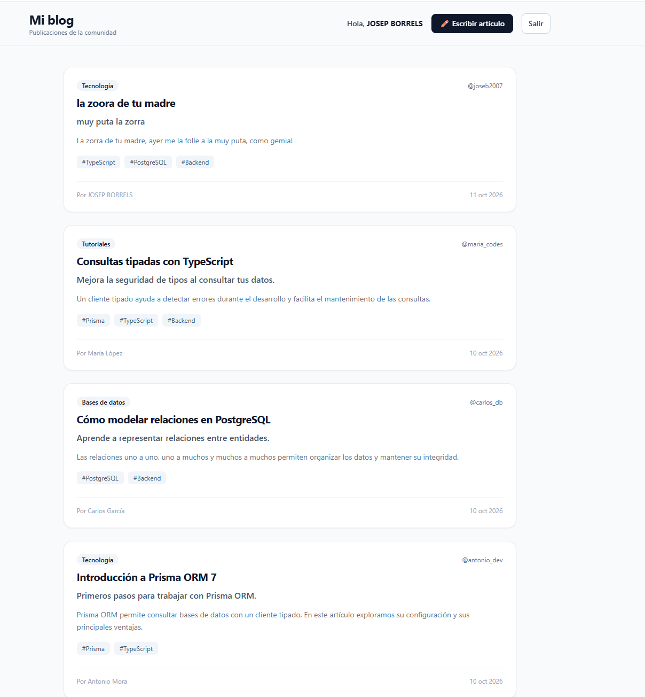
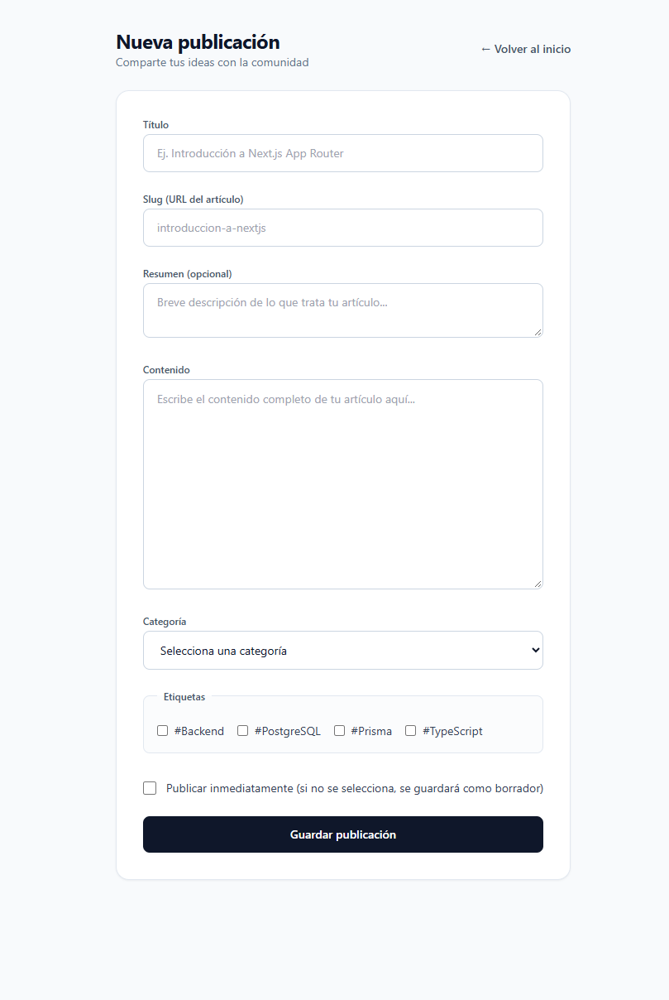
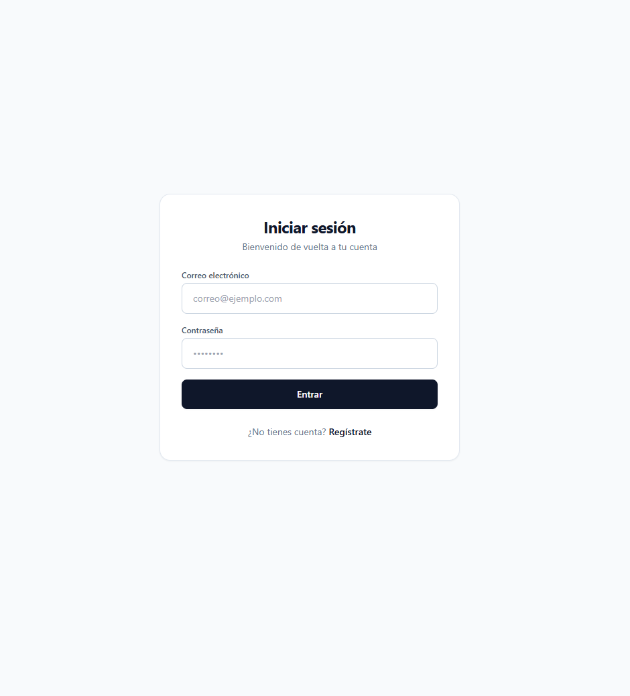
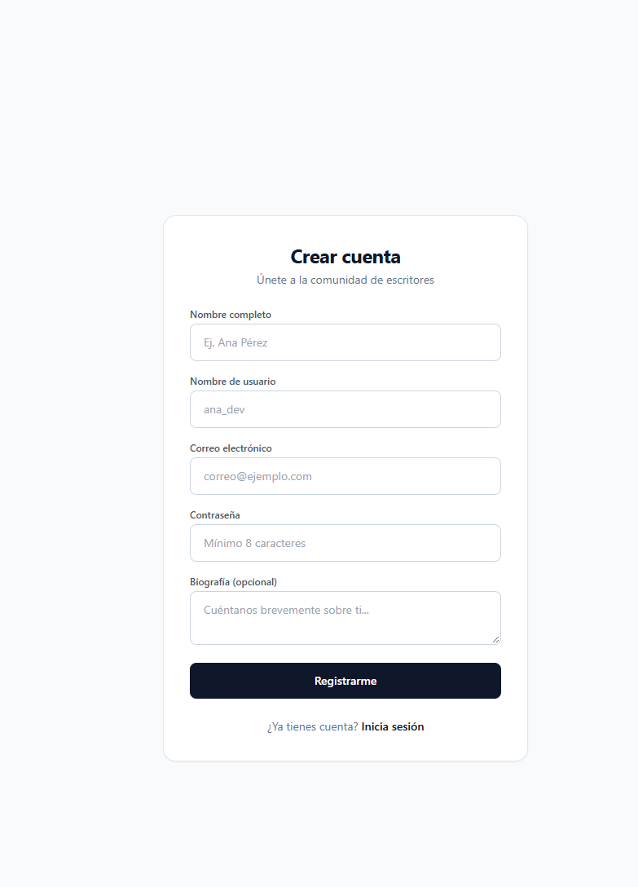

# 📚 Prisma ORM Exploration 

Este repositorio es un **proyecto inicial y maqueta conceptual** diseñado para explorar y poner en práctica las bases de **Prisma ORM** junto con **Next.js (App Router)**, **TypeScript** y **Tailwind CSS**.

El objetivo principal de este proyecto es servir como un entorno de aprendizaje para modelar relaciones, estructurar esquemas de base de datos relacionales (PostgreSQL) y maquetar una interfaz de usuario limpia para un sistema básico de publicaciones/blog.

---

## 🎨 Sistema de Diseño y Maquetación (UX/UI)

Para la maquetación visual de las vistas se utilizó una paleta moderna y refinada:

- **Tipografía Principal:** `Heebo` (Medium / Bold) — Utilizada para la interfaz, encabezados e identidad principal.
- **Tipografía Secundaria / Monospace:** `Lekton` (Regular) — Utilizada para metadatos, usernames, fechas y detalles técnicos.
- **Paleta de Colores:**
  - **Color Principal / Acentuado (`#0F172A`):** Navegación, encabezados, botones y acentos.
  - **Color de Fondo / Superficie (`#F8FAFC`):** Fondos limpios, tarjetas y contenedores de formularios.

---

## 📸 Vista Previa de la Maqueta

| Vista Principal (Dashboard) | Formulario de Nueva Publicación |
| :---: | :---: |
|  |  |

| Iniciar Sesión | Crear Cuenta |
| :---: | :---: |
|  |  |

> *Nota: Para mostrar las imágenes, coloca las capturas de pantalla en una carpeta llamada `docs/` en la raíz de tu proyecto con los nombres `dashboard.png`, `new-post.png`, `login.png` y `register.png`.*

---

## 🗄️ Exploración de Modelos con Prisma ORM

En este proyecto inicial se exploran las relaciones entre entidades clave (usuarios, publicaciones, comentarios, reacciones, seguimiento y categorías) mediante el siguiente esquema de Prisma (`schema.prisma`):

```prisma
enum PostStatus {
  DRAFT
  PUBLISHED
  ARCHIVED
}

enum ReactionType {
  LIKE
  LOVE
  CLAP
  INSIGHTFUL
}

model User {
  id           Int        @id @default(autoincrement())
  email        String     @unique
  username     String     @unique
  name         String
  passwordHash String
  role         String     @default("USER")
  isActive     Boolean    @default(true)
  createdAt    DateTime   @default(now())
  updatedAt    DateTime   @updatedAt

  profile      Profile?
  posts        Post[]
  comments     Comment[]
  reactions    Reaction[]
  bookmarks    Bookmark[]
  following    Follow[]   @relation("UserFollowing")
  followers    Follow[]   @relation("UserFollowers")
}

model Profile {
  id        Int      @id @default(autoincrement())
  bio       String?  @db.VarChar(300)
  avatarUrl String?
  website   String?
  location  String?
  userId    Int      @unique
  user      User     @relation(fields: [userId], references: [id], onDelete: Cascade)
  createdAt DateTime @default(now())
  updatedAt DateTime @updatedAt
}

model Post {
  id          Int        @id @default(autoincrement())
  title       String     @db.VarChar(180)
  slug        String     @unique
  excerpt     String?    @db.VarChar(300)
  content     String     @db.Text
  status      PostStatus @default(DRAFT)
  publishedAt DateTime?
  viewCount   Int        @default(0)
  authorId    Int
  categoryId  Int
  createdAt   DateTime   @default(now())
  updatedAt   DateTime   @updatedAt

  author      User       @relation(fields: [authorId], references: [id], onDelete: Cascade)
  category    Category   @relation(fields: [categoryId], references: [id], onDelete: Restrict)
  tags        Tag[]
  comments    Comment[]
  reactions   Reaction[]
  bookmarks   Bookmark[]

  @@index([authorId, createdAt])
  @@index([categoryId, status])
  @@index([status, publishedAt])
}

model Category {
  id          Int      @id @default(autoincrement())
  name        String   @unique
  slug        String   @unique
  description String?
  posts       Post[]
  createdAt   DateTime @default(now())
}

model Tag {
  id        Int      @id @default(autoincrement())
  name      String   @unique
  slug      String   @unique
  posts     Post[]
  createdAt DateTime @default(now())
}

model Comment {
  id        Int      @id @default(autoincrement())
  content   String   @db.Text
  userId    Int
  postId    Int
  parentId  Int?
  createdAt DateTime @default(now())
  updatedAt DateTime @updatedAt

  author    User      @relation(fields: [userId], references: [id], onDelete: Cascade)
  post      Post      @relation(fields: [postId], references: [id], onDelete: Cascade)
  parent    Comment?  @relation("CommentReplies", fields: [parentId], references: [id], onDelete: Cascade)
  replies   Comment[] @relation("CommentReplies")

  @@index([postId, createdAt])
  @@index([parentId])
}

model Reaction {
  id        Int          @id @default(autoincrement())
  type      ReactionType @default(LIKE)
  userId    Int
  postId    Int
  createdAt DateTime     @default(now())

  user      User         @relation(fields: [userId], references: [id], onDelete: Cascade)
  post      Post         @relation(fields: [postId], references: [id], onDelete: Cascade)

  @@unique([userId, postId])
  @@index([postId, type])
}

model Bookmark {
  id        Int      @id @default(autoincrement())
  userId    Int
  postId    Int
  createdAt DateTime @default(now())

  user      User     @relation(fields: [userId], references: [id], onDelete: Cascade)
  post      Post     @relation(fields: [postId], references: [id], onDelete: Cascade)

  @@unique([userId, postId])
  @@index([userId, createdAt])
}

model Follow {
  id          Int      @id @default(autoincrement())
  followerId  Int
  followingId Int
  createdAt   DateTime @default(now())

  follower    User     @relation("UserFollowing", fields: [followerId], references: [id], onDelete: Cascade)
  following   User     @relation("UserFollowers", fields: [followingId], references: [id], onDelete: Cascade)

  @@unique([followerId, followingId])
  @@index([followingId])
}
